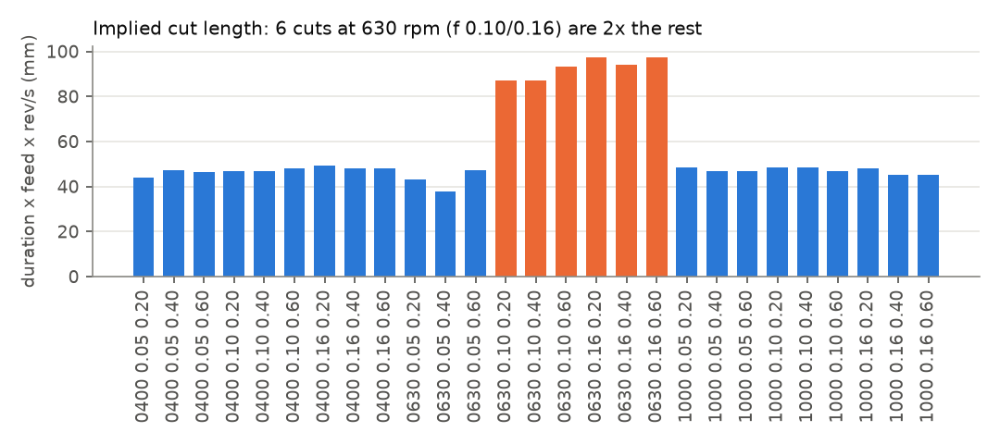
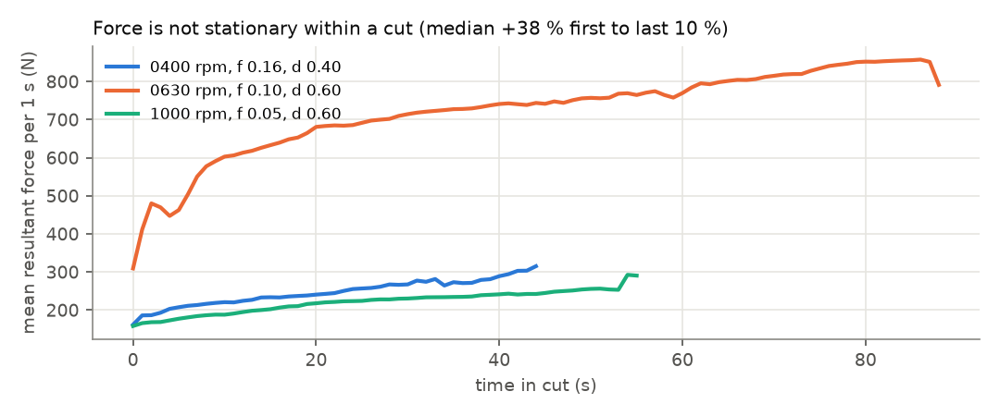
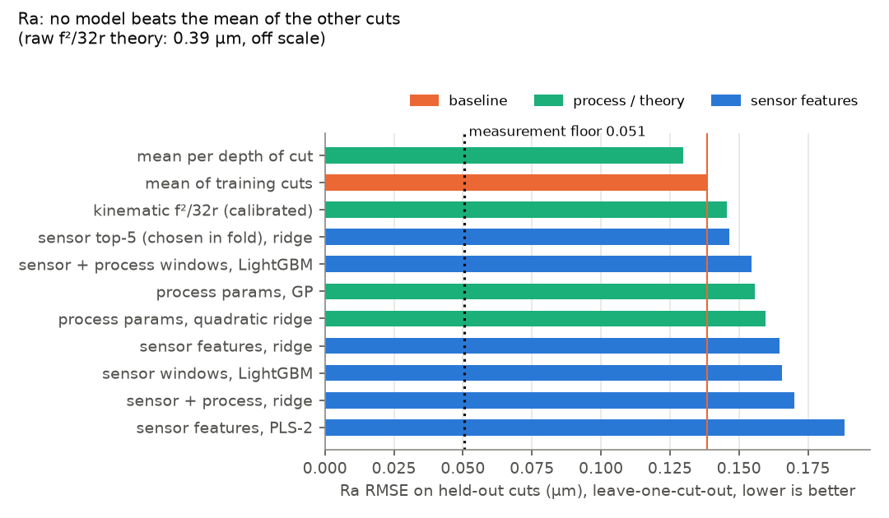
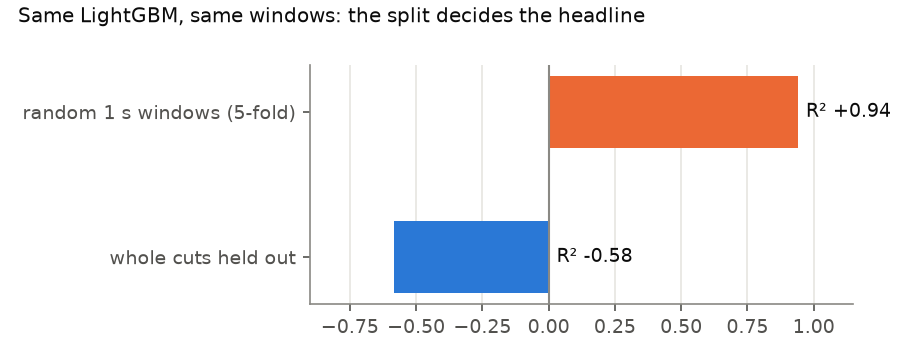

# machining-roughness-lab

Can high-frequency force and vibration signals predict the surface roughness of a machined part?
This repo answers that for a public **Inconel-625 turning** dataset (10 kHz dynamometer + 10 kHz accelerometer,
Ra/Rq/Rz measured after each cut) and builds the tooling around it that a trial-data engineer needs:
a plausibility audit, honest cut-level validation, a validation-trial planner, a trial-plan to
simulation-input-deck generator, and a results page plus Excel workbook for process engineers.

Results page: https://huggingface.co/spaces/pavanyadava07/machining-roughness-lab

## Headline

| | value |
|---|---|
| cuts (speed x feed x depth, 3 x 3 x 3) | 27 |
| 1 s windows / features per window | 1,740 / 122 |
| R² with a random window split (leaky) | **+0.94** |
| R² with whole cuts held out (same LightGBM) | **-0.58** |
| best Ra model on held-out cuts | mean per depth of cut, RMSE 0.130 µm vs 0.139 µm for the plain mean (95 % CI of the difference -0.032 .. +0.019) |
| best sensor model on held-out cuts | top-5 features chosen inside each fold, RMSE 0.147 µm (not better than the mean) |
| permutation test, sensor ridge vs shuffled Ra (300 runs) | p = 0.92 |
| Ra measurement floor from 3 repeat readings per cut | 0.051 µm, R² ceiling 0.86 |

So with this trial set, **no sensor model generalises to an unseen cut**, even though the cut-to-cut spread
(0.133 µm) is well above the measurement floor. The audit below explains a good part of why.
A random split hides all of this and reports 0.94.

## 1. Plausibility audit (`make audit`)

| check | result |
|---|---|
| implied cut length = duration x feed x rev/s is constant | **warn**: 21 cuts at 38-49 mm, the 6 cuts at 630 rpm with f 0.10/0.16 at 87-97 mm (2.0x) |
| logged spindle speed matches the force spectrum | pass: spindle line +3 to +5 % above nominal for all 27 cuts, including the 6 long ones, so their feed or pass length differs from the log (question for the lab) |
| mean force rises with chip cross-section f x d | **fail**: Spearman rho +0.45, median resultant force 37-743 N |
| force is stationary within one cut | **fail**: median +38 % from first to last 10 % of a cut, 20 of 27 cuts beyond +-20 % (tool wear or offset drift) |
| vibration level ordered by speed | warn: 400 rpm 0.344 g, 630 rpm 0.090 g, 1000 rpm 0.173 g, speeds look like separate sessions |
| roughness repeatability | pass: median CV 9 % over 3 readings, worst cut 35 % |
| gross outliers | warn: one Rz reading of 8.3 µm (cut 1000/0.16/0.60) |




## 2. Models (`make evaluate`)

Unit of evaluation is the cut. Every window of a held-out cut is unseen in training (tested in
`tests/test_eval_audit_plan.py`). Leave-one-cut-out has 27 folds, leave-one-speed-out has 3.

| Ra model | RMSE cut-out (µm) | R² cut-out | RMSE speed-out |
|---|---|---|---|
| mean per depth of cut | 0.130 | +0.05 | 0.122 |
| mean of training cuts (baseline) | 0.139 | -0.08 | 0.136 |
| kinematic f²/32r, calibrated | 0.146 | -0.19 | 0.150 |
| sensor top-5 (chosen in fold), ridge | 0.147 | -0.21 | 0.264 |
| sensor + process windows, LightGBM | 0.155 | -0.34 | 0.186 |
| process params, GP | 0.156 | -0.36 | 0.162 |
| process params, quadratic ridge | 0.160 | -0.43 | 0.159 |
| sensor features, ridge | 0.165 | -0.52 | 0.136 |
| sensor windows, LightGBM | 0.166 | -0.54 | 0.185 |
| sensor + process, ridge | 0.170 | -0.63 | 0.308 |
| sensor features, PLS-2 | 0.188 | -0.99 | 0.421 |
| kinematic f²/32r, raw | 0.390 | -7.55 | 0.390 |

Rz shows the same picture (floor 0.32 µm, best: mean per depth 0.75 µm vs mean 0.84 µm, CI includes zero).
The raw kinematic formula predicts 0.10-1.0 µm from feed alone; the measured Ra (0.24-1.05 µm) does not follow feed at all
(Spearman -0.03), so for Inconel at these feeds something other than tool-nose geometry dominates the surface.




Features per 1 s window and channel (Fx, Fy, Fz, resultant, 3 acceleration axes): mean, std, RMS, robust
peak-to-peak, skewness, kurtosis, crest factor, Welch band-energy shares (0-20, 20-100, 100-500, 500-1000,
1000-2500, 2500-5000 Hz), spectral centroid, total power, amplitude at the 1st and 2nd spindle harmonic; plus
resultant force per nominal chip area and two force ratios.

## 3. What to run next (`make plan`)

A Gaussian process on speed, feed and depth (length scales bounded to at least 0.5 standard deviations as a
smoothness prior) finds only depth informative (length scales 20, 20, 0.5). Greedy max-variance selection,
exact because GP variance does not depend on the measured values, proposes depth 0.3 and 0.5 mm at the
speed/feed corners. First, re-run or clarify the six double-length cuts. Repeat readings shrink the floor as
1/sqrt(n): 0.088 µm for one reading, 0.051 for three, 0.039 for five.

## 4. Trial plan -> simulation input decks (`make decks`)

```
python -m mrl.siminput examples/grinding_plan.csv --out decks/grinding
4 decks written to decks/grinding, 2 rows rejected
  line 6 (G05): work_speed_m_min: Input should be less than or equal to 60
  line 7 (G06): depth_mm: Input should be greater than 0
```

Each row is validated with pydantic (ranges, geometry, speed ratio q = vs/vw >= 10 to catch m/s vs m/min mix-ups)
and the derived quantities are computed in one place: for grinding q, equivalent chip thickness
heq = ae vw / vs, specific removal rate Q'w = ae vw, geometric contact length sqrt(ae ds); for turning cutting
speed, removal rate, kinematic Ra and cut time. Decks come from plain `key = value` templates in `templates/`,
so the format can be matched to any tool. The format here is generic and not any company's real input format.

## 5. Results for engineers (`make report`)

`docs/index.html` (one self-contained page, also the Hugging Face Space) and `results/roughness_report.xlsx`
(sheets Summary, Models_Ra, Models_Rz, Predictions, Plausibility, Next_trials, Replicates).

## Run it

```
make setup      # uv, Python 3.11, pinned requirements.lock
make data       # 81 CSVs, about 1.7 GB, sha256 checked against data/meta/manifest_v3.json
make features audit evaluate plan report decks
make gate       # ruff + 16 pytest tests on synthetic data, no download (this is what CI runs)
```

Runtime on a CPU box: features 46 s, evaluation about 2 min (27 + 3 folds x 12 models x 2 targets,
300 permutations, leakage demo).

## Limits

- One public dataset: 27 cuts on one bar of Inconel-625, one insert type, turning not grinding.
- Roughness is measured at three random points per cut, so it cannot be tied to individual windows.
- Force axis mapping (cutting / feed / passive) is not documented in the dataset, so features use Fx/Fy/Fz and the resultant.
- A negative result here says this trial set is too small and too inconsistent for a sensor model.
  It does not show that sensor-based roughness models cannot work with more cuts and stable force data.

## Data

H. Harigovind, B. Nair, N. R. Sakthivel, *A Sensor based turning dataset for data-driven surface roughness
estimation*, Mendeley Data v3, doi:10.17632/ybyhxv4czd.3, CC BY 4.0. The data is not redistributed here;
`make data` downloads it. Derived numbers in `results/` are from that data.

Code: MIT, Pavan Yadav Annappa.
